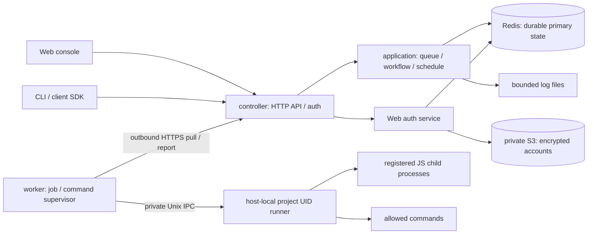

# システム構成・モジュール・共通時刻

ナビゲーション: [概要](../../README.md) ｜ [索引](../README.md) ｜ [要件・概念](01-requirements.md) ｜ [導入・SDK](02-project-integration.md) ｜ **構成・UTC（現在）** ｜ [永続化・反映](04-storage.md) ｜ [実行](05-execution.md) ｜ [ログ・監視](06-observability.md) ｜ [開発・運用](07-operations.md) ｜ [API](08-api.md) ｜ [セキュリティ](09-security.md) ｜ [Web認証](10-web-authentication.md) ｜ [設定](11-configuration.md) ｜ [controller分散](12-controller-distribution.md) ｜ [release](13-release.md) ｜ [検証・計画](14-validation-plan.md) ｜ [一次資料](15-references.md)

状態: **設計文書・未実装**。確定要件/採用契約と数値提案/未決を区別する。読む順序と正本は [設計索引](../README.md) を参照。

## 配置と責務



初期MVPのsingle profileはcontroller一つ・Redis primary一つ・複数worker。singleのowner guardは二重起動を拒否する。複数配置するmulti profileではactive-active APIとして登録controller集合/各起動epochと共有deployment generationを検査し、single-owner条件を使わない。generationはrestore世代で、controller追加/再起動ごとに全体を更新しない。Redisは同居/専用hostとも可能で、複製/failoverは必須にしない。[分散profile契約](12-controller-distribution.md) に従う。

controller層がRedisのアプリケーション書込窓口となり、worker は認可済み mTLS/HTTPS API を使う。これは supervisor に共有 DB の書込権限を配らず、job/host/attempt 単位の認可を broker で強制する選択である。Redis ACL だけで共有 queue 内の細かな belt 認可を代替しない。AWS VPC 内の private DNS/IP でも TLS を使い、管理者が CA と到達範囲を設定する。[通信の運用例](07-operations.md#aws-vpc-transport) を参照。共有 state により複数 executor を統合するが、Redis 導入だけで controller の複数稼働・HA が完成するわけではない。multi profileでは原子的schedule cursor/occurrenceとjob leaseで調停し、共有LogStoreも必須条件にする。API分散とRedis障害復旧を混同しない。

HTTP の受付成功と実行許可は Redis の所定の耐久性 ACK 後に返す。メモリイベント・Pub/Sub は起床通知の最適化に留め、失われても Redis の状態走査で復元する。初期 config は JSON ファイル、ジョブ状態は Redis、大量 stdout/stderr と通信断時 spool はファイルに分ける。job実行状態を別DBに重複保存しない。Web accountは別責務として [非公開S3正本](10-web-authentication.md#account-store) を使い、Redisはsession/replay/失効照合を持つ。

管理ホスト上で実行する場合も worker を別プロセスで立てる。MVPのworkerがホスト識別・許可manifest・ローカル実行記録と共通resource collectorを持つ。指定サーバー向け専用agentは後続であり、この図/起動に含めない。supervisorがheartbeat/制御資格情報を管理し、別UIDのrunner serviceが業務registryとchildを管理する。OS管理の起動境界がなければdispatchを拒否する。CPU boundなJSは制御event loopから分け、別UID/credential境界を必須にする。詳細は [実行境界](09-security.md#execution-boundary)。

## リポジトリ構成案

```text
apps/
  controller/       # composition root、HTTP 起動、Redis 接続
  worker/           # credential を持つ supervisor の起動（業務moduleをimportしない）
  runner-service/   # OS管理のproject別UIDでregistryをimportし子processを起動
  cli/              # コマンドの構文・終了コード
  console/          # 静的 HTML/CSS/TypeScript由来browser JS、API 経由のみ
packages/
  sdk/              # 利用側向け公開 facade: defineJob/defineRegistry/config/client
  contracts/        # JSON 型、version、error codes、wire の検証
  domain/           # 状態遷移、DAG 検証、retry/dispatch policy、ports
  application/      # enqueue/claim/finish/cancel/reconcile 等の use case
  storage-redis/    # domain ports、Redis client/Lua、key schema、migration
  storage-files/    # LogStore: immutable chunk/atomic publish。multiでは検証済み共有FS
  definition-source/ # 定義/非機密共通設定の読取 port、filesystem adapter
  source-s3/        # 定義用の任意S3 adapter
  auth/             # Web TOTP/session/registration use cases、AccountStore/SecretProtector ports
  accounts-s3/      # 当面のaccount正本CAS adapter、AWS SDK/envelope helperを隔離
  schedule/         # UTC固定の次回時刻計算/JSON検証。timezone resolver不要
  transport-http/   # HTTP route、auth 境界、request/response 変換
  telemetry/        # Linux/Nodeのread-only収集、正規化、集約契約（OS固有を隔離）
  executor/         # lease client、supervisor、bounded spool
  runner-node/      # 登録済み 型チェック済み TypeScript handler の compiled JS を子プロセスで動かす
  runner-command/   # executable/argv、OS signals、exit code
  client/           # Node https/mTLS transport とbrowser fetchのAPI client
tests/
  contracts/ integration/ faults/ acceptance/
examples/
  handlers/ definitions/ linux/
docs/design/        # 設計ドキュメント
```

このツリーは belt 本体の構成であり、利用側の業務 job の配置先ではない。利用側には安定した SDK/CLI の公開 entry point を提供し、内部 packages の deep import や本体 fork を要求しない。公開 package 名は仮に `belt` と表記する。公開範囲・名称は実装時に確定する。最初から全内部 package を npm 公開する必要はない。npm workspaces と TypeScript project references で内部 import を検査し、`src/` への deep import を禁止する。ESM の compiled JS と `.d.ts` を成果物にし、利用者に ts-node を要求しない。利用側の handler も TypeScript と型チェック成功を必須とする。

## 依存方向と独立 API

矢印 `A → B` は「A が B を import できる」を示す。

```text
contracts → なし（ECMAScript のみ、browser 可）
domain → contracts（Node/DB/HTTP/時計/乱数への直接アクセスなし）
application → domain, contracts
storage-redis / storage-files / schedule → domain, contracts
definition-source → contracts（readRelease/publish の port と filesystem 実装）
source-s3 → definition-source の公開 port, contracts（定義用任意 adapter）
auth → domain, contracts（AccountStore/SecretProtector/OTPVerifier port、具体libraryはcompositionで注入）
accounts-s3 → auth の公開 port, contracts（AWS SDK/envelope依存、workerへ配布しない）
transport-http → application, contracts
telemetry → contracts（Linux/Node adapter、Redis/HTTPに直接依存しない）
client → contracts
sdk → contracts, client（公開 facade、Redis/controller 実装を import しない）
executor → client, contracts, RunnerBroker の port（private Unix IPC/固定runner境界）
runner-node / runner-command → contracts, executor の公開 runner 型
apps → 必要な実装を組み立てる（supervisorとrunnerのOS権限は別）
console → contracts の browser-safe 出力 または wire JSON
```

domain に `Store`, `Clock`, `Random`, `ScheduleCalculator`, `LogStore` の port を置く。application はその port を constructor で受け取り、adapter を import しない。executor の runner 型は独立した公開型として提供し、runner と executor の循環依存を作らない。console は DB や controller の内部コードを共有しない。

| package | 公開 API の例 | 再利用時の境界 |
| --- | --- | --- |
| sdk | `defineJob`、`defineRegistry`、`defineProject`、`createClient` | 利用側 TypeScript 向け公開 API。内部 client/domain と公開契約を混同しない |
| contracts | `parseEnqueue(unknown): Result<Enqueue>`、`ProtocolVersion` | 型だけでなく入力の深さ・長さ・enum を検証 |
| domain | `transition(state, event)`、`validateDag(def)`、`planRetry(policy, attemptNo, previousDelayMs, nowUtcMs, retryDeadlineAtUtcMs, random)` | 副作用なし。時計と乱数は引数 |
| application | `enqueue`、`claim`、`renew`、`finish`、`cancel`、`tick` | 認可済み principal と原子的な専用操作 port を受ける |
| definition-source / source-s3 | `readRelease(ref)`、`readPublishedRef()`、`publish(expectedRevision, manifest)` | 概念 API。取得した byte列/immutable参照/競合を返す。S3等の具体型を domain に出さず、認可付き apply/activate は application が担う |
| storage-redis | `openStore(config): Store`、`migrate`、`health` | Redis key/client/Lua と耐久性エラーを隠す。backup は運用手順 |
| schedule | `validateSchedule`、`nextOccurrences(spec, afterUtc, limit)`、`planMisfire` | pureなUTC計算core。interval index / UTC calendar label / UTC instantを返す。時計/Redis/timerへの直接依存なし。timezone引数やresolver不要 |
| LogStore / storage-files | `putChunk(id, bytes, hash)`、`readChunk(ref)` | immutable chunkをdurableに公開。Redis metadataと非原子的なのでreceipt/hashで照合。multiでは全controllerが読める共有実装 |
| telemetry | `collect(scope, clock): ResourceSample`、`validateSample` | 概念 API。read-onlyの固定指標とunavailable理由、単位/sourceを返す。送信/Redis保存はapplication/transportが担当 |
| client | `enqueue`、`getRun`、`claim`、`report` | API timeout、idempotency key、protocol version |
| executor | `runExecutor(config, runnerBroker)` | DB依存なし。lease/heartbeat制御、限定runner IPC。registryや業務JSをimportしない |
| runner | `start(task, context): RunningTask` | 別UID runner内で署名/許可registryを照合。terminate/終了Promise/streamを提供。supervisor credentialなし |

```ts
// 概念 API。実装時は branded ID と判別 union を確定する。
interface Store {
  enqueue(input: ValidEnqueue, context: MutationContext): Promise<Durable<RunRef>>;
  claim(input: ClaimRequest, context: MutationContext): Promise<Durable<Assignment[]>>;
  renew(input: LeaseRef, context: MutationContext): Promise<Durable<LeaseDecision>>;
  finish(input: FinishReport, context: MutationContext): Promise<Durable<FinishDecision>>;
  // cancel、DAG 解放、schedule tick、監査等も専用の原子的操作にする。
}
// Durable receipt を返せない timeout は「未実行」とは扱わず、同じ操作 ID で照合する。
interface HandlerContext {
  runId: string;
  attemptId: string;
  effectKey: string; // 同一論理操作の retry で固定
  signal: AbortSignal;
  log(event: { level: string; message: string }): void;
}
```

Store は汎用的な SQL transaction callback を要求せず、enqueue/claim/finish 等の原子的な操作と耐久性 receipt を契約にする。adapter 内の短い固定 Lua script 等で状態条件と関連 index/監査をまとめて更新し、TypeScript の domain policy を Redis 固有型から切り離す。script source を入力から生成せず、KEYS/ARGV で値を渡す。公開 port の契約試験を将来の別 adapter にも適用する。

<a id="utc-time-policy"></a>

### UTC の絶対日時と経過時間の契約

**保存/通信/API/Redis/ログ/実行履歴/監査/telemetry/JSON journal/manifestの絶対日時はUTCに統一する。** UTCを既定とし、OS/ブラウザーのlocal timezoneやprocess.env.TZで意味を変えない。APIの日時文字列は厳密なRFC3339/ISO8601のZ終端（出力例2026-10-27T09:00:00.000Z、入力は秒必須・小数秒は0〜3桁）とする。Redis内部や数値契約ではUnix epoch milliseconds（UTC）を明記した型/field schemaを使い、seconds/millisecondsを推測して変換しない。安全整数/有効な日時範囲を検証し、不正日付の自動繰上げ・naive local datetime・曖昧なslash形式を拒否する。日時入力もUTCのZ表記に限定し、非UTC offsetやnaive local入力を自動解釈/変換して受理しない。

対象にはcreated/updated/queued/notBefore/deadline/started/finished、lease expiry、schedule due/cursor、credential/session期限、反映報告/heartbeat、telemetry observed/received/bucket、backup/export/releaseの作成日時を含む。APIの既存field名にUtc接尾辞がない場合もschemaでUTC表記/epoch msを固定する。executor epochやrevision/fencing tokenは世代/順序であり、Unix epoch日時とは別型にする。

telemetryのsource observedAtとcontroller receivedAtは両方UTCとして区別し、stale/履歴bucket/48時間windowはcontroller受信のUTC epoch msを基準にする。client時計のずれ・再起動・欠測を測定値0へ変換しない。共有release/定義の署名は保存したcanonical byte列に対して検証し、表示変換でmanifestを再serialize/再署名しない。

プロセス内のduration計測、HTTP待ち/timeout/drain/backoff、heartbeat経過、安全余裕、CPU割合の差分区間はperformance.now()/process.hrtime.bigint()等の単調時計で扱う。durationの保存/通信は単位付き数値（通常ms、CPUcounterの内部単位は明示）で、単調時計の絶対origin値を別process/再起動後の日時へ流用しない。再起動を跨ぐdeadline/lease/保持期間の期限はUTCに保存し、再開時にUTCで照合して残りdurationを単調時計へ写す。NTP step/時計不明時は既存の保留/照合契約に従い、単調時計だけで全hostの時刻同期を代替しない。

Webの表示はUTCが既定。JSTならAsia/Tokyo/UTC+09:00等を表示領域に明示して同じinstantを変換表示するだけとし、機械可読API/export/CLI出力はUTCに固定する。日時入力とschedule編集はUTCを明示し、WebでJST表示中も入力欄はUTCとして区別する。表示zoneの変更を定義の編集・UTCへの書戻し・実行時刻の変更にしない。

schedule定義・評価もUTC固定。calendar field/無効日/曜日と入力拒否の詳細は [scheduler仕様](05-execution.md#native-scheduler) を正本とし、表示timezoneを実行規則にしない。

beltの構造化logger/監査timestampはUTCのZ文字列、stdout/stderr chunkの取得・受付timestampもUTCにする。jobが書く生テキスト内の日付をbeltが推測変換・保証するものではなく、raw本文は非解釈textとする。journaldの保存/表示時刻はOS管理の別層で、journalctl等の表示設定がlocalでもbelt JSON内のUTC timestampを変更しない。利用側の型付きloggerにもUTC timestamp契約を適用し、業務日付等のdate-only情報を実行instantと混同しない。

## 依存予算

| 分類 | 初期提案 | 境界・理由 |
| --- | --- | --- |
| Node 標準 | http/https/tls、crypto、fs/path、stream、child_process、worker_threads、util.parseArgs、test/assert、global fetch/AbortController/Intl | HTTP/queue/logger/test framework は必須にしない |
| OS/runtime | Linux、systemd（推奨）、CA 証明書、時刻同期、ローカル FS、Node 内包 OpenSSL/ICU | ログと spool の file 保存を含む。単なる依存ゼロとは呼ばない |
| npm runtime 必須案 | node-redis（`redis` package とその必要な推移依存） | storage-redis に限定。Node 標準に Redis protocol client はなく、RESP/TLS/再接続を自作しない |
| scheduler runtime | 追加npm依存なし。標準DateのUTC演算、Node timer/単調時計 | UTC暦とJSON定義/Redis due/cursorで管理。timezone DB/逆変換/外部日時libraryは不要。IntlはWeb表示変換だけ |
| 認証/OS境界の依存例外 | Webの標準TOTP/ローカルQR/envelope暗号libraryとAWS SDK、必要なsession/署名検証library、狭いOS runner helperは審査して許容 | mTLS/OS機能は対象環境で検証。独自暗号/認証protocol/RESPclientを依存削減のために作らない。公開用SSOは後続 |
| npm development | TypeScript、@types/node。必要なら formatter/linter | 本番 runtime と区別し lockfile/license を監査 |
| browser | TypeScript sourceを開発時にcompileしたES modules、platform HTML/CSS/fetch/SVG | React/Vue/bundler/CDN/外部フォントは MVP 必須にしない |
| 外部 service | job実行主基盤はRedis。採用Web認証には非公開S3/KMS | 定義用S3は任意。accountのS3/KMS・AWS SDK/envelope/TOTP/QR libraryは用途を限定した明示依存。Cognito/別queue serviceは必須にしない |

[公式推奨 node-redis](https://redis.io/docs/latest/develop/clients/nodejs/) を使い、接続再確立・offline queue・自動再送の方針を固定する。クライアントの再送機能だけに冪等性を委ねず、operation ID と Redis receipt で照合する。client、script、Redis の対象版・license・推移依存・更新方針を依存台帳に残す。

scheduleは標準DateのUTC演算を使う小さな独立計算モジュールとし、JSON interval/calendarを計算してRedisの実行管理につなぐ。UTC暦・計算境界・時計の契約は [schedule 設計](05-execution.md#native-scheduler) を参照。Redis 固有の小さな Lua script は storage adapter 内の実装であり、domain/handler の TypeScript API を Lua に依存させない。
